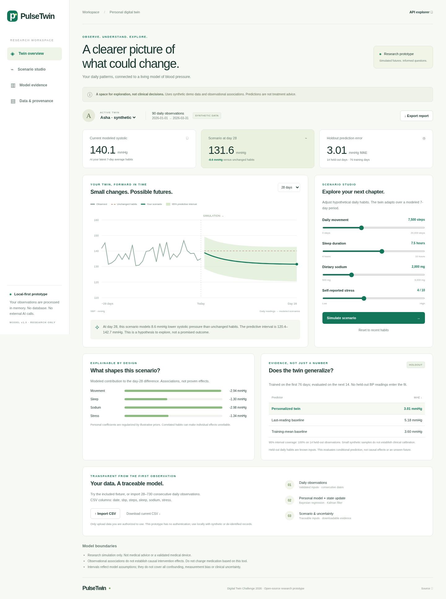
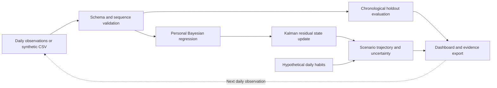

# PulseTwin

### Personal health, simulated. A transparent blood-pressure digital twin.

PulseTwin turns consecutive daily blood-pressure and lifestyle observations into a personalized, updating model. Explore hypothetical movement, sleep, sodium and stress scenarios, inspect predictive uncertainty, compare against simple baselines, and export the evidence behind each result.

**Digital Twin Challenge 2026 · Functional research prototype · Synthetic demonstration only**



## Submission details

| Item | Details |
|---|---|
| Project title | PulseTwin — An Interpretable Personal Blood-Pressure Digital Twin |
| Team | PulseTwin; author name in local Git metadata: Yashwanth M; repository owner: [@YashwanthPb](https://github.com/YashwanthPb). Legal participant names, membership and eligibility have not been verified. |
| College / incubator | Not supplied or verified. No institutional affiliation is claimed. This mandatory registration detail remains outstanding. |
| Public repository | https://github.com/YashwanthPb/Digital_Twin_Challenge — published to `main`; public repository page and raw README, PDFs and MP4 verified accessible (HTTP 200). |
| Architecture PDF | [System architecture](docs/architecture.pdf) |
| Presentation PDF | [Project presentation and outcomes](docs/presentation.pdf) |
| Demo materials | [18:53 narrated MP4](artifacts/pulsetwin-demo.mp4), [narrated demo script](docs/demo-script.md), [captions](artifacts/demo.srt), [video production notes](docs/DEMO.md) |
| 15–20 minute unlisted YouTube demo | **Outstanding:** the rendered demo must be uploaded to an authorized YouTube account as unlisted and its actual URL added here. No upload or URL is fabricated. |
| Open-source license | [MIT](LICENSE), covering original code, documentation and synthetic fixtures. Third-party dependencies retain their own licenses. |
| Submission status | Technical package prepared; **not yet a complete contest submission**. See [mandatory checklist](docs/SUBMISSION.md). |

The organizer webpage could not be read from this environment (HTTP 403 network-policy response). Requirements were transcribed from the supplied submission-form screenshot. Eligibility, deadlines, judging criteria and additional organizer rules remain unverified. No claims of compliance beyond the available checklist are made.

## Problem statement

A blood-pressure chart records what happened but does not explain how a person's daily patterns relate to it. Generic wellness dashboards rarely offer a personal, inspectable model or an honest estimate of uncertainty. People and researchers need a way to ask “what if these patterns changed?” without treating a model as a prescription.

**Healthcare use case:** longitudinal cardiometabolic research and shared discussion of daily patterns. PulseTwin models systolic blood pressure (SBP), updating a personal model and residual state when observations arrive. A researcher can import de-identified daily records, compare a hypothetical lifestyle scenario to unchanged recent habits, and inspect model evidence. It does not diagnose hypertension, recommend treatment, change medications, or triage emergencies.

## Run in two minutes

Requires Python 3.12 and access to PyPI for the initial installation. No API keys, database, GPU or paid services.

```bash
python -m venv .venv
.venv/bin/python -m pip install -r requirements.txt
.venv/bin/python -m uvicorn pulsetwin.app:app --host 127.0.0.1 --port 8000
```

Open port 8000 locally in your browser. The root route is the dashboard; `/docs` is the interactive API documentation. `/api/health` returns `status: ok`. After installation, the app runs without external network calls. Keep the server local: this prototype has no user authentication or production security hardening.

For an exact copy of the tested development environment, install `requirements-lock.txt` (including transitive dependencies). For development and validation:

```bash
.venv/bin/python -m pip install -r requirements-dev.txt
.venv/bin/python -m unittest discover -s tests -v
.venv/bin/python scripts/evaluate.py
# With the server running and system Chromium installed:
.venv/bin/python scripts/browser_check.py
```

An alternative browser installation is `python -m playwright install chromium`; set `CHROMIUM_PATH` to that browser executable if it is not `/usr/bin/chromium`. Browser automation and document generation are development-only dependencies.

## Judge walkthrough

1. Load **Asha · synthetic**. Inspect the 90 observations and current modeled SBP (140.1 mmHg with the included data).
2. Review the default 28-day scenario. Its modeled SBP is 131.6 mmHg; the wide predictive interval remains visible. These numbers are generated from synthetic data.
3. Change movement to 12,000 steps and click **Simulate scenario**. Compare the modeled curve, baseline and contribution bars.
4. Choose a 56-day horizon. The assumptions and horizon-dependent uncertainty remain explicit.
5. Switch to Dev or Mira to see different personal fits. Import `data/mira.csv` to exercise real CSV parsing.
6. Inspect chronological holdout metrics and both baselines. Download the JSON report and CSV data for reproducibility.
7. Try an invalid CSV: the server rejects malformed headers, missing values, invalid dates, non-finite/out-of-range inputs, duplicate days, gaps and insufficient history.

## What makes this a digital twin?

This is a **data-driven, human-in-the-loop digital twin prototype**, not a high-fidelity physiological replica. It has a person-specific model, a changing latent state, an observation-update cycle, and a conditional simulation loop. Each import refits the Bayesian coefficients and filters daily residuals. The current snapshot and hypothetical inputs determine future trajectories. Live device ingestion, automatic synchronization and patient feedback are roadmap items, not implemented features.



## Technical stack and AI/ML details

- **Backend:** Python 3.12, FastAPI, Pydantic; stateless JSON API.
- **Model:** NumPy Bayesian linear regression with Gaussian regularization, followed by a scalar Kalman filter for the residual BP state.
- **Frontend:** semantic HTML, responsive CSS, vanilla JavaScript and inline SVG. No CDN, frontend build step or external AI service.
- **Evaluation:** `unittest`, FastAPI TestClient and Playwright/Chromium acceptance checks.
- **Documents:** reproducible ReportLab PDFs and local video tooling.

Inputs: date, systolic BP (mmHg), daily steps, sleep (hours), sodium (mg/day), and self-reported stress (0–10). Requires 28–730 consecutive daily observations.

The personal regression learns an intercept plus four lifestyle associations. Illustrative Gaussian priors stabilize small datasets. A scalar Kalman filter tracks residual drift. Scenario inputs approach their targets with a seven-day exponential time constant. The unchanged-habits comparator uses the most recent seven-day input averages. The 95% Gaussian posterior predictive band includes coefficient uncertainty, residual-state uncertainty, fixed observation noise and accumulating process variance.

**No pretrained network, LLM, external training dataset or causal identification is used.** Prior means, noise and adaptation constants are engineering assumptions, not individualized clinical effect estimates. Details, equations and caveats are in the [model card](docs/MODEL_CARD.md).

## Measured prototype outcomes

Evaluation uses a chronological 76-day training / 14-day test split for each 90-day synthetic fixture. Held-out lifestyle covariates are known; held-out BP labels never enter fitting. These are conditional prediction tests, not prospective intervention trials.

| Synthetic profile | Twin MAE (mmHg) | Last-reading MAE | Training-mean MAE | 95% interval coverage |
|---|---:|---:|---:|---:|
| Asha | 3.01 | 5.18 | 3.60 | 14/14 |
| Dev | 3.19 | 5.49 | 3.85 | 14/14 |
| Mira | 2.81 | 5.41 | 4.47 | 14/14 |

Full predictions: [evaluation.json](artifacts/evaluation.json). The generator uses a relationship similar to the fitted model, so these results are an implementation check and may be optimistic. Perfect coverage on 14 observations does not prove calibration; the intervals may be conservative. No real-world health outcomes or clinical accuracy have been demonstrated.

**Verified:** 14 model/API tests and browser acceptance checks for loading, scenario changes, horizons, profile switching, CSV import/reselection, export, invalid input and mobile overflow. [Validation report](docs/VALIDATION.md).

## Privacy, safety and limitations

- Three deterministic synthetic profiles; names are fictional labels. No patient records, secret keys or credentials are included.
- No server-side record storage, analytics or external model requests. Uploaded data is transmitted to the local API, held in memory and returned to the current browser. Reports downloaded by the user contain the input observations.
- No accounts, access control, encryption-at-rest or regulatory certification. Do not expose this prototype as a clinical service.
- Observational confounding, self-report error, fixed noise, correlated predictors, non-causal coefficients and population differences limit interpretations.
- Model boundaries and out-of-range scenario warnings are visible in the app. The system does not prescribe or make diagnostic decisions.

## Repository map

```text
pulsetwin/       API, schema validation, model and evaluation logic
web/             Responsive interactive dashboard
data/            Reproducible synthetic JSON and CSV fixtures
tests/           Model and API tests
scripts/         Data generation, evaluation, browser tests, documents and video
artifacts/       Screenshots, evaluation results, captions and demo output
docs/            Architecture PDF, presentation, model card and submission guide
```

## References and next steps

Background references (not validation of this model): [WHO hypertension overview](https://www.who.int/news-room/fact-sheets/detail/hypertension), [DASH-Sodium trial](https://doi.org/10.1056/NEJM200101043440101), and [Kalman's filtering paper](https://doi.org/10.1115/1.3662552).

Next steps require consented longitudinal data, a preregistered external evaluation, calibration across subgroups, missingness and measurement-quality handling, clinician review, secure ingestion and prospective investigation of interventions. Real-device integration and clinical deployment are intentionally future work.
